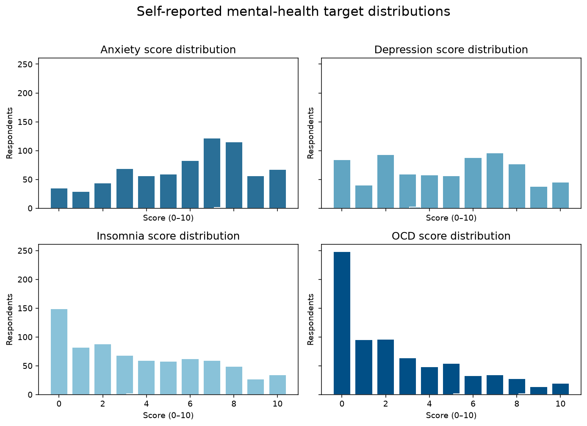
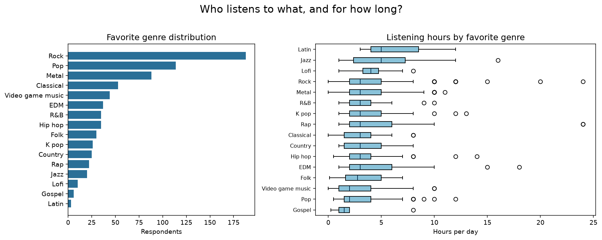
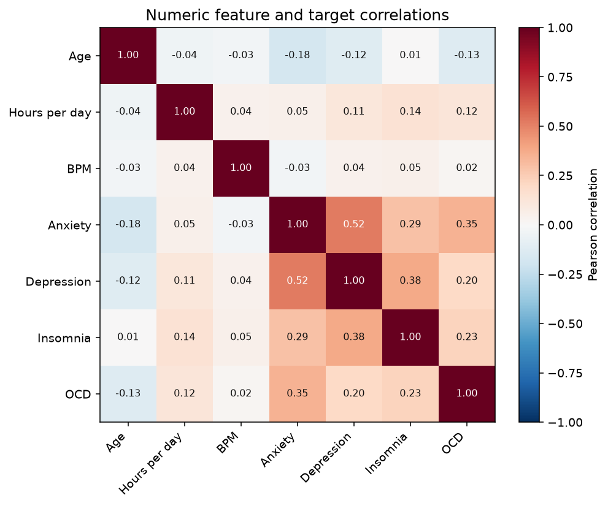
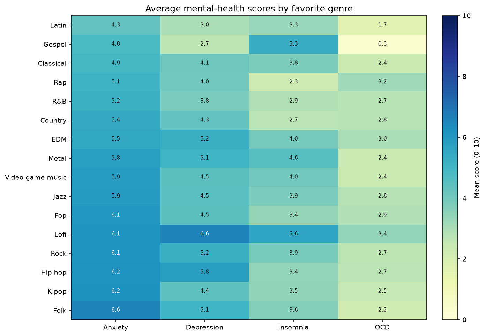
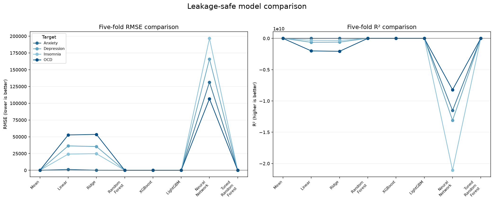
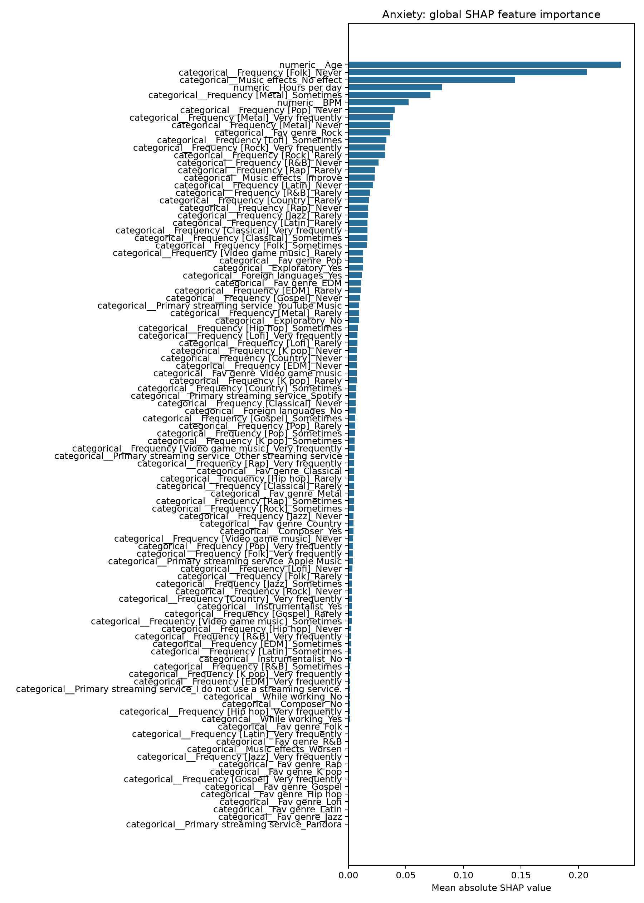
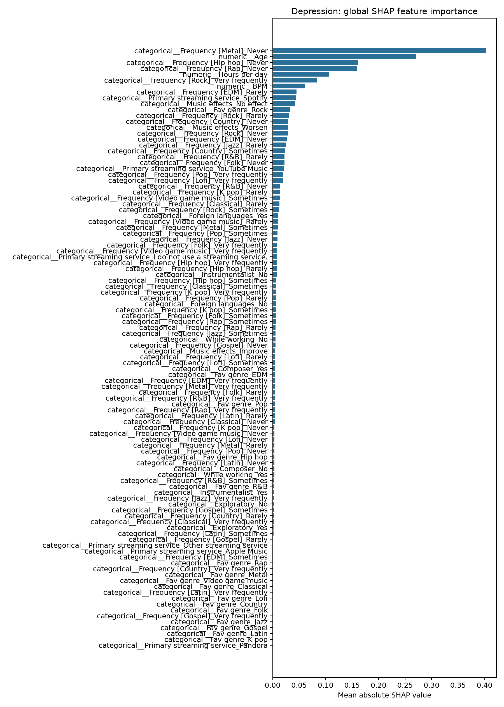
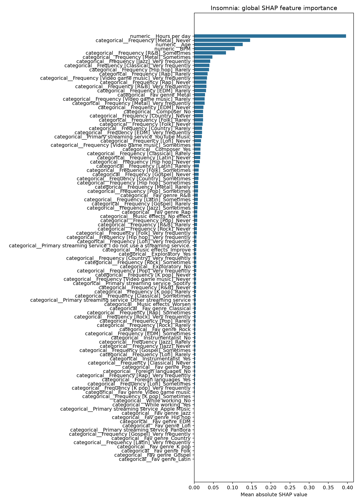
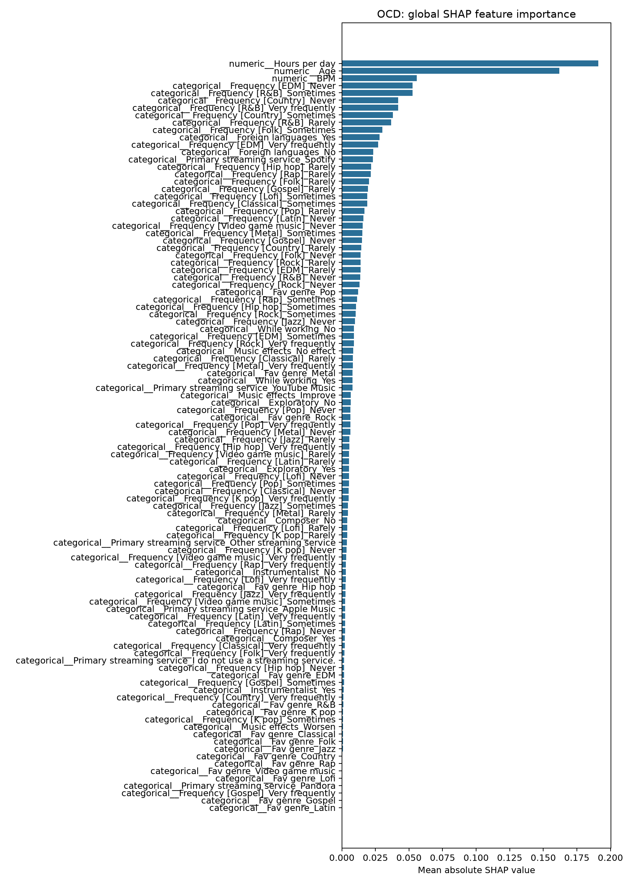

# Music and Mental Health Recognition

An end-to-end machine-learning project that predicts self-reported **Anxiety,
Depression, Insomnia, and OCD** scores from music listening habits. The project
covers exploratory analysis, leakage-safe preprocessing, model benchmarking,
Optuna tuning, SHAP explainability, and deployable FastAPI and Streamlit apps.

> **Important:** This project is for educational and portfolio purposes only.
> It is not a diagnostic tool and must not be used for medical decisions.

## Project snapshot

| Dataset | Targets | Validation | Best model |
| --- | --- | --- | --- |
| 736 survey responses | Four 0–10 scores | 5-fold cross-validation | Tuned Random Forest |

### Dataset exploration

The survey contains demographics, listening frequency across genres, streaming
habits, BPM, and self-reported mental-health scores.









## Key findings

- The tuned Random Forest was the strongest overall model in five-fold cross-validation, but predictive signal was limited: R² was **0.04** for Anxiety, **0.07** for Depression, **-0.02** for Insomnia, and **-0.00** for OCD.
- Cross-validated RMSE was **2.73** for Anxiety, **2.91** for Depression, **3.08** for Insomnia, and **2.83** for OCD on the 0–10 self-reported scales.
- SHAP explanations identified age, hours listened per day, BPM, and genre-frequency indicators as the most influential features. The strongest features differed by target, with age prominent for Anxiety and Depression and listening hours prominent for Insomnia and OCD.
- These are predictive associations in a self-reported survey, not evidence that music habits cause changes in mental health.

## Model comparison

All preprocessing, missing-value imputation, and categorical encoding are fit
inside each cross-validation fold. The chart below compares the requested
baseline and ensemble models using RMSE and R².



## Model interpretability visualizations

The global SHAP plots below rank the encoded survey features by their average
impact on each target model. Larger mean absolute SHAP values indicate greater
influence on predictions, not causation.

| Anxiety | Depression |
| --- | --- |
|  |  |

| Insomnia | OCD |
| --- | --- |
|  |  |

Per-prediction waterfall explanations are available for [Anxiety](results/figures/anxiety_prediction_0.png),
[Depression](results/figures/depression_prediction_0.png),
[Insomnia](results/figures/insomnia_prediction_0.png), and
[OCD](results/figures/ocd_prediction_0.png).

## Run the prediction apps

Generate the persisted multi-target model bundle before starting an app:

```bash
python -m src.train
uvicorn app.api:app --reload
# or, in another terminal:
streamlit run app/streamlit_app.py
```

Both interfaces display the same disclaimer: this project is not a diagnostic tool.
